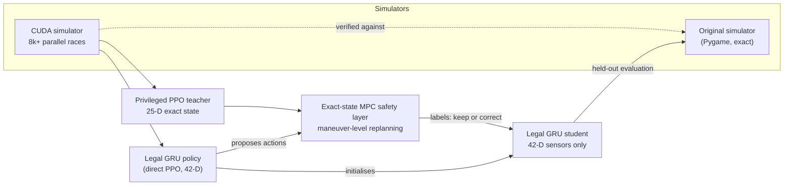

# Teacher-student distillation for a partially observed racing policy

A privileged teacher that sees the exact simulator state drives almost crash-free. A deployable student
that sees only ray sensors and its own action history does not. This project builds the pieces to close that
gap on the [DM i AI 2025 race-car](https://github.com/amboltio/DM-i-AI-2025) simulator:
- a GPU-native simulator, validated against the original;
- a privileged PPO teacher;
- an exact-state MPC safety layer around the teacher;
- distillation of MPC corrections into a recurrent student that uses only legal observations, with
  dataset aggregation (DAgger-style).

The selected student cuts the held-out crash rate from **91.4% to 39.8%** and raises mean distance from
**35.9k to 62.5k**. It is still an experimental policy, not a safe one; see [Limitations](#limitations).

## Problem

The ego car chooses one of five primitive actions every tick (`NOTHING`, `ACCELERATE`, `DECELERATE`,
`STEER_LEFT`, `STEER_RIGHT`). It drives on a five-lane road with up to four opponents that move with a random
walk. The score is distance travelled before a crash or the time limit. Steering changes *lateral velocity*,
not position, so a lane change needs about 48 ticks of steering and 48 of counter-steering.

At deployment the policy sees only the **legal observation**: 16 ray-sensor distances with hit masks, ego
velocity, time, distance, the previous action, and a lateral position the controller tracks from its own
actions (42 values). The teacher instead gets a 25-D privileged state: exact positions and velocities of
every car.

## Method



1. **Fast, validated simulation.** A batched PyTorch simulator runs thousands of races on the GPU. Two
   verifiers guard it: [`verify_fast_sim.py`](scripts/verify/verify_fast_sim.py) checks bit-for-bit
   parity of the scalar reference against the original, and [`verify_gpu_sim.py`](scripts/verify/verify_gpu_sim.py)
   checks exact ego dynamics, observations and collision geometry plus statistical traffic parity. Every
   reported number comes from the **original** simulator on fixed seeds, never from the training simulator.
2. **Privileged teacher.** PPO trains a teacher on the exact state ([`train_teacher_gpu.py`](scripts/train/train_teacher_gpu.py)).
   Crash forensics sorted its failures into same-lane, lane-change and wall crashes and traced lane-change
   crashes back to the tick the maneuver started ([`analyze_teacher_crashes.py`](scripts/analysis/analyze_teacher_crashes.py)).
   A counterfactual replay tool then tested individual fixes ([`analyze_teacher_counterfactuals.py`](scripts/analysis/analyze_teacher_counterfactuals.py)).
3. **MPC safety layer.** When traffic is relevant, an exact-state receding-horizon planner compares
   maneuver-level plans (teacher continuation, settle, left, right, accelerate, brake, coast). It inflates
   opponent rectangles by a 3σ random-walk envelope and overrides the teacher only when the teacher's own plan
   looks unsafe ([`evaluate_teacher_mpc.py`](scripts/eval/evaluate_teacher_mpc.py)).
4. **Distillation with correction.** Running the original simulator on 24 CPU workers, the MPC labels every
   state the student visits, and the student updates on CUDA ([`train_distilled_gru_mpc.py`](scripts/train/train_distilled_gru_mpc.py)).
   The version that worked starts from an already competent legal GRU, trained by direct PPO, and lets that
   frozen policy propose actions. The MPC changes only the proposals it judges unsafe. This turns distillation
   into a safety-correction problem: corrections get 8× loss weight, and an auxiliary left/stay/right head
   learns the MPC's chosen maneuver.
5. **Selection gate.** Checkpoints are ranked first by the share of episodes that crash or end below 25k,
   then by crash rate, and only then by 10th-percentile (p10) and mean distance. A policy that simply stops
   therefore cannot win by avoiding collisions.

## Results

Original simulator, deterministic decoding. **Dev** is the 64-seed selection block starting at seed 400,000.
**Held-out** is 256 untouched seeds starting at seed 1,100,000. Source:
[experiment log, "Privileged-teacher distillation into the legal GRU"](docs/experiment_log.md#privileged-teacher-distillation-into-the-legal-gru).

| Student | Held-out crash | Held-out mean | Held-out p10 | Held-out < 25k | Dev crash | Dev mean |
|---|---:|---:|---:|---:|---:|---:|
| Source: legal GRU from direct PPO | 91.4% | 35.9k | 7.0k | 58.2% | 93.8% | – |
| MPC-corrected (1,001,472 labels) | 47.3% | 53.8k | 6.3k | 39.5% | 48.4% | 49.3k |
| + one dataset-aggregation generation | 47.7% | – | 5.4k | – | – | – |
| **+ auxiliary lane-option head (selected)** | **39.8%** | **62.5k** | 6.0k | **37.1%** | **34.4%** | **66.5k** |

"–" means the number is not reported in the log. All held-out crashes of the selected student were collisions
with opponents, none with walls.

The safety layer on its own, around the privileged teacher, on a 512-seed held-out block starting at seed
300,000 ([log, "Sequence-level receding-horizon privileged MPC"](docs/experiment_log.md#sequence-level-receding-horizon-privileged-mpc)):

| | Teacher | Teacher + MPC |
|---|---:|---:|
| Crashes | 51 / 512 | **1 / 512** (50 rescued, 0 introduced) |
| Paired crash-rate change | | −9.77 pp, 95% bootstrap CI [−12.30, −7.23] |
| p10 distance | 32.5k | **64.4k** |
| Episodes below 25k | 9.6% | 3.5% |
| Ticks on which the MPC triggers | | 18.7% |

## What did not work

These are kept in the log on purpose:
- **Distilling the MPC into a fresh student** (2,002,944 exact labels): the best checkpoint crashed in 98.4%
  of dev episodes (mean 10.9k, p10 2.9k). On the same seeds the MPC teacher had 0% crashes, p10 81.6k and mean
  162.6k, so the failure lies in transfer to partial observation, not in the teacher. A further 50%
  student-behaviour aggregation pass did not pass the safety gate either.
- **One more dataset-aggregation generation** after the corrected student matched its crash rate (47.7%)
  but lowered p10 to 5.4k, so it was **rejected** by the gate.
- **A lane-change initiation shield** on the teacher increased crashes from 10.5% to 17.9% on 2,048 seeds,
  because blocked steering requests built up scheduler pressure. It was replaced by the MPC.
- **A per-tick, one-primitive safety filter** got worse as its horizon grew. One primitive differs too
  little from the others under these lateral dynamics, so the MPC plans whole maneuvers instead.
- **Decoding the lane-option head directly:** thresholds below 0.4 caused excessive or wall-crossing
  maneuvers. The head is used only as an auxiliary training target.

## Limitations

- **The selected student is not safe:** 39.8% of held-out episodes still crash, and p10 (6.0k) is below the
  source policy's 7.0k. The gap to the privileged MPC teacher (0% dev crashes) is still large.
- Checkpoint selection used the 64-seed dev block. The held-out block was used only to report results, but
  the log reports a single training run per configuration, with no repeats over training seeds.
- Checkpoints, logs and per-seed evaluation outputs live under `models/` and are not committed. That is why
  this README has tables but no training curves.

## What is upstream and what is mine

| Path | Origin |
|---|---|
| `src/`, `public/assets/` | Upstream simulator from [`amboltio/DM-i-AI-2025/race-car`](https://github.com/amboltio/DM-i-AI-2025) |
| `training/` | Fast and CUDA simulators, legal and privileged environments, PPO and recurrent PPO, distillation, MPC |
| `scripts/train`, `scripts/eval`, `scripts/verify`, `scripts/analysis` | Training entry points, original-simulator evaluation, fidelity verifiers, crash forensics |
| `controller.py`, `api.py`, `dtos.py`, `run_controller.py`, `lateral_tracker.py` | Heuristic lane controller, competition `/predict` API and action-only lateral tracker |

## Running it

Python 3.12 and a CUDA GPU are needed for training; the verifiers and original-simulator evaluation run on CPU.
Run everything from the repository root, as modules:

```bash
python -m venv .venv && source .venv/bin/activate
pip install -r requirements.txt

# Fidelity checks before any training run
python -m scripts.verify.verify_fast_sim --seeds 50 --max-steps 2000
python -m scripts.verify.verify_gpu_sim --device cuda
python -m scripts.verify.verify_teacher_mpc

# Selected student: MPC correction of a direct-PPO legal GRU, with the lane-option head
python -m scripts.train.train_distilled_gru_mpc \
  models/gpu_teacher_65k_1b/best_teacher.pt \
  --init-student-checkpoint models/direct_gru_2p5b/best_deterministic.pt \
  --proposal-student-checkpoint models/direct_gru_2p5b/best_deterministic.pt \
  --proposal-mode deterministic \
  --transitions 1001472 \
  --workers 24 \
  --rollout-steps 256 \
  --data-seed-start 900000 \
  --learning-rate 1e-4 \
  --hard-weight 0 \
  --soft-weight 1 \
  --trigger-sample-weight 2 \
  --override-sample-weight 8 \
  --lane-option-loss-weight 1 \
  --lane-option-positive-weight 32 \
  --eval-every 251904 \
  --eval-episodes 64 \
  --eval-seed-start 400000 \
  --output models/direct_gru_mpc_options_v1
```

The teacher (`gpu_teacher_65k_1b`) and the direct-PPO source policy (`direct_gru_2p5b`) come from the earlier
stages in the [experiment log](docs/experiment_log.md). That log has every command, the evaluation commands
for each stage, and the heuristic controller and API (`python run_controller.py`, `python api.py`).
